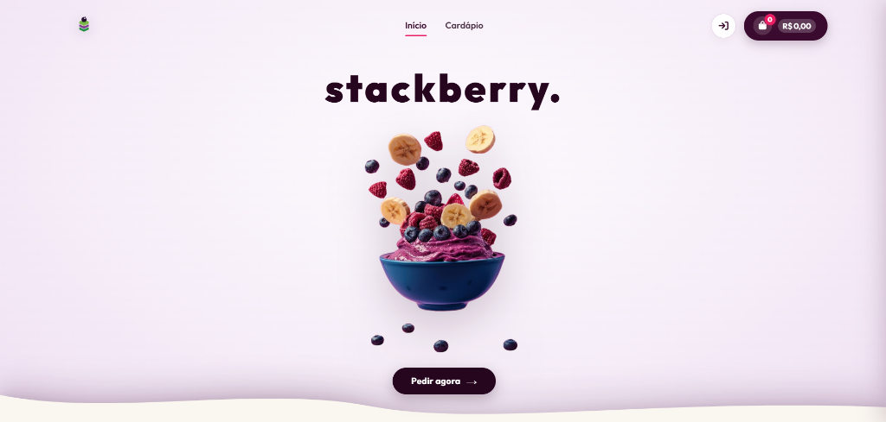
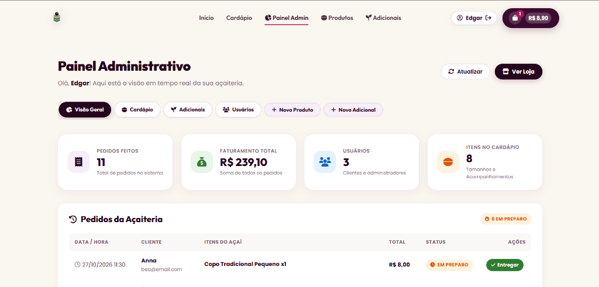
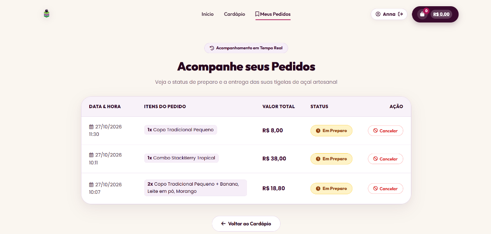
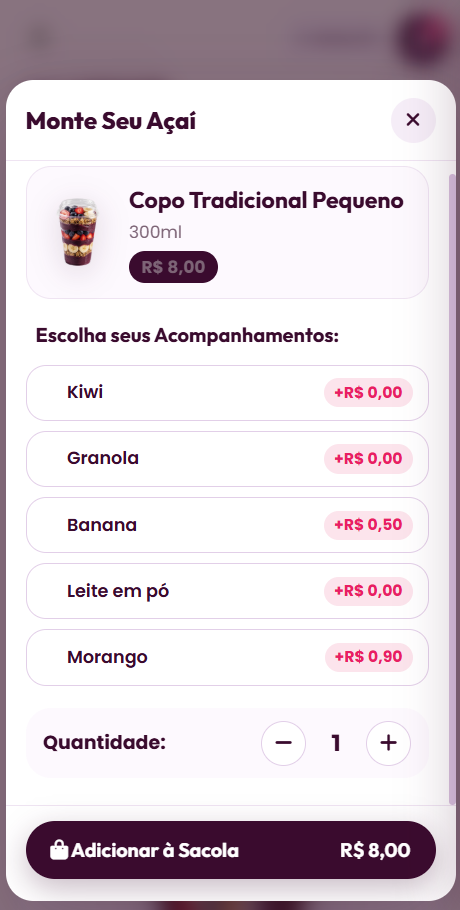
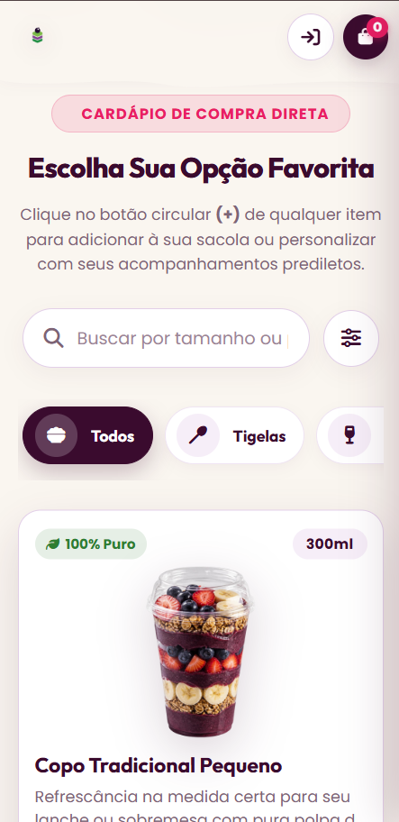
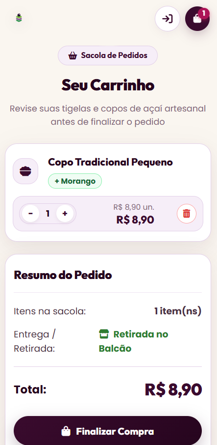

<p align="center">
  
</p>

<h1 align="center">StackBerry - Açaiteria Artesanal & Sistema de Gestão</h1>

<p align="center">
  <em>Do stack de tecnologia à tigela de açaí: experiência editorial, pedidos dinâmicos e controle administrativo em tempo real.</em>
</p>

<p align="center">
  
  
  
  
</p>

---

## 🎓 Contexto do Projeto & Evolução

* **Origem:** Projeto concebido originalmente para a disciplina de **Análise e Projeto de Sistemas (APS)** na **Universidade Federal da Paraíba (UFPB - Campus IV)**.
* **Evolução & Refatoração Completa:** O projeto passou por uma reformulação integral liderada por **Anna Vasconcelos** ([@Annabdv](https://github.com/Annabdv)), transformando a aplicação em uma plataforma de açaiteria moderna com **identidade editorial, vitrine artesanal, modal customizador, checkout interativo, painel administrativo e total responsividade para dispositivos móveis**.
* **Assistência de IA no Processo:** A refatoração visual e a implementação dos tokens de design foram desenvolvidas utilizando fluxos avançados de **Pair Programming com Inteligência Artificial**, acelerando a prototipagem de CSS nativo, estruturação semântica e auditoria de layout responsivo.

---

## 📌 Sumário

* [Visão Geral](#-visão-geral)
* [Demonstração Visual](#-demonstração-visual)
* [Diferenciais de Design & UI/UX](#-diferenciais-de-design--uiux)
* [Tecnologias Utilizadas](#-tecnologias-utilizadas)
* [Funcionalidades](#-funcionalidades)
  * [Área do Cliente](#-área-do-cliente)
  * [Painel Administrativo](#-painel-administrativo)
* [Responsividade & Mobile-First](#-responsividade--mobile-first)
* [Como Executar o Projeto](#-como-executar-o-projeto)
* [Equipe & Autoria](#-equipe--autoria)

---

## 📖 Visão Geral

O **StackBerry** é um ecossistema completo para açaiterias artesanais, unindo atendimento digital intuitivo para o cliente a uma ferramenta ágil de retaguarda para o operador. 

O cliente pode navegar pelas tigelas de açaí, selecionar tamanhos, combinar frutas e acompanhamentos com cálculo em tempo real, gerenciar sacola e encaminhar o pedido pronto com um clique para o WhatsApp. Do lado administrativo, a equipe visualiza métricas de faturamento em tempo real, gerencia o cardápio e acompanha cada etapa dos pedidos.

---

## 📸 Demonstração Visual

### 💻 Experiência Desktop & Vitrine Editorial
<p align="center">
  
</p>

### ⚙️ Painel Administrativo em Tempo Real
<p align="center">
  
</p>

### 📋 Acompanhamento de Pedidos do Cliente
<p align="center">
  
</p>

### 📱 Experiência Interativa & Mobile-First
<table align="center" width="100%">
  <tr>
    <td align="center" width="33%" style="vertical-align: top;">
      <strong>Customizador "Monte seu Açaí"</strong><br>
      <em>Seleção em chips e steppers</em><br><br>
      
    </td>
    <td align="center" width="33%" style="vertical-align: top;">
      <strong>Cardápio no Smartphone</strong><br>
      <em>Pesquisa instantânea e carrossel</em><br><br>
      
    </td>
    <td align="center" width="33%" style="vertical-align: top;">
      <strong>Sacola &amp; Checkout</strong><br>
      <em>Resumo e confirmação</em><br><br>
      
    </td>
  </tr>
</table>

---

## 🎨 Diferenciais de Design & UI/UX

A identidade visual foi construída sobre os pilares do **Design Editorial & Artesanal**, proporcionando uma experiência acolhedora e refinada:

* **Paleta de Cores Curada:**
  - 🍇 **Açaí Puro & Bagas:** Tons fechados e sofisticados (`#26051E`, `#3A0B2E`) para títulos, contraste e identidade de marca.
  - 🍦 **Creme Artesanal:** Fundos neutros e suaves (`#FAF6F0`, `#F6EEF8`) que valorizam os produtos e evitam fadiga visual.
  - 🌿 **Verde Natural & Frutas:** Cores de destaque para preços, confirmações e tags de frescor (`#2E7D32`, `#AD1457`, `#E65100`).
* **Tipografia Moderna:** Combinação da família [Outfit](https://fonts.google.com/specimen/Outfit) (títulos encorpados e numerais destacados) com [Poppins](https://fonts.google.com/specimen/Poppins) (legibilidade em textos longos).
* **Navbar Inteligente com Efeito de Vidro:** Cabeçalho com transição suave baseada em rolagem (`backdrop-filter: blur(12px)`) e terminação com ondas orgânicas em SVG.
* **Componentes Exclusivos:**
  - *Hero Minimalista:* Foco no produto com açaí em alta definição e frutas flutuantes.
  - *Carrossel de Categorias:* Navegação por chips com ícones e rolagem suave.
  - *Cards Treato Style:* Cartões com badges de popularidade, indicador de volume e botão de adição rápida.
  - *Slide-Over Drawer da Sacola:* Acesso rápido aos itens sem recarregar a tela.

---

## 🛠️ Tecnologias Utilizadas

O sistema foi construído mantendo total fidelidade às tecnologias originais, com zero frameworks pesados no cliente para máxima performance:

* **Backend:** [Java 21 (LTS)](https://www.oracle.com/java/)
* **Servidor Web & Roteamento:** [Javalin 6.7.0](https://javalin.io/) (leve, baseado em Jetty 11)
* **Template Engine:** [Thymeleaf](https://www.thymeleaf.org/) com [Thymeleaf Layout Dialect](https://github.com/ultraq/thymeleaf-layout-dialect)
* **Frontend:** HTML5 semântico, Vanilla CSS3 (Design Tokens e Grid/Flexbox puros) e JavaScript ES6 / jQuery
* **Ícones & Recursos:** Font Awesome 6.5.2 & Google Fonts
* **Armazenamento de Dados:** Persistência estruturada em arquivos JSON
* **Gerenciador de Dependências:** [Apache Maven](https://maven.apache.org/)

---

## ✨ Funcionalidades

### 👤 Área do Cliente
- **Vitrine e Busca Instantânea:** Pesquisa em tempo real de tigelas, copos e sobremesas, com filtragem por categorias.
- **Customizador de Tigela ("Monte seu Açaí"):** Modal interativo para adicionar frutas, granolas, caldas e complementos com soma de valores em tempo real.
- **Sacola Dinâmica & Carrinho:** Ajuste de quantidade por steppers dedicados, cálculo de subtotais e resumo do pedido.
- **Checkout com WhatsApp:** Geração automática da mensagem estruturada com itens, adicionais, total e envio direto para o atendimento do restaurante.
- **Meus Pedidos em Tempo Real:** Visualização do status atualizado (`Em Preparo`, `Entregue` ou `Cancelado`) com histórico de pedidos do cliente.
- **Autenticação:** Telas de Login e Cadastro personalizadas, com validação de credenciais e proteção de rotas.

### 🔑 Painel Administrativo
- **Visão Geral com KPIs:** Cartões com contagem de pedidos, faturamento acumulado, usuários cadastrados e produtos ativos.
- **Abas de Navegação em Linha Única:** Navegação deslizante e ergonômica entre seções do dashboard.
- **Gestão de Produtos & Acompanhamentos:** Criação, edição e exclusão de itens com galeria integrada e pré-visualização de fotos.
- **Controle de Pedidos:** Acompanhamento dos pedidos da loja com avanço de etapas de preparo.
- **Gestão de Usuários:** Listagem de clientes e permissões de acesso.

---

## 📱 Responsividade & Mobile-First

Todas as telas do StackBerry foram projetadas e testadas para funcionar perfeitamente em qualquer dispositivo:

- **Sem Rolagem Lateral:** Layouts com contenção inteligente (`overflow-x: hidden`), eliminando barras de rolagem horizontais indesejadas.
- **Adaptação de Tabelas para Cartões:** Em smartphones (<= 768px e <= 480px), tabelas densas (como histórico de pedidos e tabelas administrativas) se convertem automaticamente em **cards verticais**, mantendo todas as ações acessíveis por toque.
- **Navegação Adaptativa:** Carrosséis de categorias e abas administrativas contam com rolagem por deslize (*touch reel*), otimizando o espaço da tela.

---

## 🚀 Como Executar o Projeto

### Pré-requisitos
* **Java JDK 21** instalado e configurado nas variáveis de ambiente (`JAVA_HOME`).

### Método Rápido (Windows)
Basta dar dois cliques no arquivo:
```bat
iniciar.bat
```
O script iniciará o servidor Javalin e abrirá o navegador automaticamente no endereço da aplicação.

### Método Manual (Terminal)
```bash
# 1. Clone o repositório
git clone https://github.com/Annabdv/sistema-acaiteria-stackberry.git

# 2. Acesse a pasta do projeto
cd sistema-acaiteria-stackberry

# 3. Execute o pacote compilado
java -jar target/s_berry-1.0-jar-with-dependencies.jar

# 4. Abra o navegador em:
http://localhost:7070
```

> **Credenciais padrão para testes:**
> - **Cliente:** Acesse a tela `/login` ou crie uma conta em `/cadastrar`.
> - **Administrador:** Acesso disponível conforme dados configurados no sistema.

---

## 👥 Equipe & Autoria

* **Anna Vasconcelos** ([@Annabdv](https://github.com/Annabdv)) — Integrante da equipe original na disciplina de APS; concepção visual, arquitetura de UI/UX, implementação de responsividade mobile e refatoração completa do sistema.
* **Edgar Henrique** ([@Edgar-sh](https://github.com/Edgar-sh)) — Integrante da equipe original na disciplina de APS.
* **Randerson Ranniery** ([@randersonranniery7](https://github.com/randersonranniery7)) — Integrante da equipe original na disciplina de APS.
